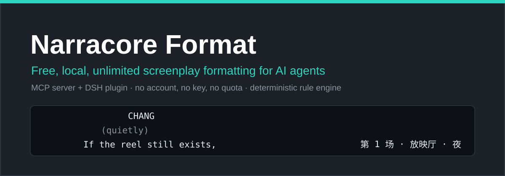

[English](README.md) | [Español](README.es.md) | [Français](README.fr.md) | 日本語 | [한국어](README.ko.md) | [繁體中文](README.zh-Hant.md)

<p align="center"></p>

# Narracore Format

**無料・ローカル・無制限の、AI エージェント向け脚本組版。** ラフな原稿を、すぐ撮れる脚本へ——[DSH](https://github.com/deepseek-ai/deepseek-harness) プラグインを兼ねるオープンソースの MCP サーバーです。**中国語・英語・混在テキストに対応（日本の放送劇形式・中国語コロン形式の台本稿を含む）。組版エンジンがトラックを自動選択します：CJK は 33 字 × 38 行グリッド、ラテンは 61 × 55 グリッド**——[narracore.cn](https://narracore.cn?utm_source=github-plugin) と同一の固定タイプライター字格です。

- **永久無料**——自分のマシンで動作。アカウント不要・キー不要・利用制限なし・通信なし
- **決定的**——純粋なルールベース エンジン。内部に LLM なし。同じ入力は常にバイト単位で同じ出力
- **エージェント向け**——機械可読な診断、証拠を逐字検証するシーン採点、ツール間の型付きブロック連鎖契約

[Narracore](https://narracore.cn?utm_source=github-plugin) ツールキットのオープンソース版コアです。**印刷用 PDF エクスポート**やフルの物語連続性ツールが必要なら、下の[エコシステム](#エコシステム)を参照してください。

## 例

ラフな文字を入れると、組版済みの脚本が出てきます。以下はどちらもエンジンの実際の出力です。

<details open>
<summary><b>中国語（CJK 33×38 グリッド）</b></summary>

入力——一行一要素の緩いテキスト：

```text
第 1 场 内 老式放映厅 - 夜

放映机的光柱切开黑暗，尘埃在光里悬浮。
常家青坐在最后一排，手里攥着一张褪色的电影票。

常家青
（低声）
如果胶片还在，就能证明那晚的一切。

检票员从阴影里走出来，把手电筒照在票面上。

检票员
这张票，二十年前就该作废了。

常家青站起身。光柱突然熄灭。

切至黑暗
```

出力——`format_screenplay` の `plain_text`（シーン見出し・ト書き・登場人物・パレンセティカル・セリフ・右揃えトランジション、すべて固定字格上）：

```text

第 1 场 内 老式放映厅 - 夜


放映机的光柱切开黑暗，尘埃在光里悬浮。


常家青坐在最后一排，手里攥着一张褪色的电影票。


                       常家青
                    （低声）
          如果胶片还在，就能证明那晚的一切。


检票员从阴影里走出来，把手电筒照在票面上。


                       检票员
          这张票，二十年前就该作废了。


常家青站起身。光柱突然熄灭。


                                                          切至黑暗
```

</details>

<details>
<summary><b>English（ラテン 61×55 グリッド）</b></summary>

入力：

```text
INT. PROJECTION BOOTH - NIGHT

The projector beam cuts through the dark.

CHANG
(quietly)
If the reel still exists,
it proves that night was real.

CUT TO BLACK.
```

出力：

```text

INT. PROJECTION BOOTH - NIGHT


The projector beam cuts through the dark.


                   CHANG
             (quietly)
         If the reel still exists,

         it proves that night was real.


                                                CUT TO BLACK.
```

</details>

同じ呼び出しは、型付き `blocks`（シーン・ト書き・登場人物・パレンセティカル・セリフ・トランジション・ショット・注記）、ページ統計、機械可読な診断も返します——これらのブロックをそのまま他のツールに渡せば、分析や変換を続けられます。

## インストール

### DSH（DeepSeek Harness）——メインチャネル

```sh
dsh plugin add narracore-format
```

以上です。エージェントに `mcp__narracore__*` 名前空間の 5 ツールが追加されます。

### 任意の MCP クライアント（Claude Code、Cursor など）

本パッケージは標準の stdio MCP サーバーなので、どの MCP クライアントからでも直接実行できます：

```jsonc
// Claude Code: claude mcp add narracore-format -- npx -y narracore-format@latest
// Cursor / 汎用 MCP 設定：
{
  "mcpServers": {
    "narracore-format": { "command": "npx", "args": ["-y", "narracore-format@latest"] }
  }
}
```

Node ≥ 22 が必要です。

## ツール（5 個）

| ツール | 機能 |
| --- | --- |
| `format_screenplay` | 脚本テキスト（または型付きブロック）を 8 種の意味ブロック・組版済みテキスト・ページ統計・診断へ。`output="validate_only"` は組版せず構造のみ検査。 |
| `analyze_screenplay` | 決定的な統計：構造化シーン見出し（場番号・場所・時間帯・INT/EXT）付きシーン一覧、シーンごとの文字数・セリフ比率・動作密度、登場人物の出番表。 |
| `diagnose_scenes` | シーン単位の「撮影可能性」診断：エージェントが証拠を引用し、ツールがそれを逐字検証して 0–100 点を精确計算（重大度加重覆盖率、点数の捏造は一切なし）。 |
| `convert_fountain` | Narracore 型付きブロックと [Fountain](https://fountain.io)（脚本プレーンテキスト交換形式）の双方向変換。 |
| `about_narracore` | エコシステム概要——Narracore の他の機能。 |

**連鎖契約：**同じ脚本に別ツールを使うときは、整形済みテキストではなく受け取った `blocks` をそのまま渡してください（`input_format="blocks"`）——ブロックは決定的に解析され、テキストは再解析されます。

## エコシステム

- **[narracore.cn](https://narracore.cn?utm_source=github-plugin)**——本ツールキットの源：完全な長編共創ワークベンチ。同一組版に加え、ローカルフォーマッタではできないストーリーウィンドウ連続性ツールを提供。
- **[narracore.app](https://narracore.app?utm_source=github-plugin)**——同一パイプラインのホスト型 MCP サービス。フォント埋込の**印刷用 PDF エクスポート**（表紙・ヘッダー・署名付きダウンロードリンク）を追加提供。インストールなしで PDF パイプラインが必要な場合は、こちらで N 回分の組版サービスを購入できます。

## エンジンの来歴

`src/format/` の組版エンジンは narracore.cn と同一の単一ソース。Narracore コードベースから逐字移植（来歴ハッシュは [`src/format/README.md`](src/format/README.md)）され、**スナップショットテストがバイト単位で固定**します——スナップショット全緑は、本パッケージが narracore.cn のウェブアプリと逐字同じ組版を行う機械的証明です。分析層（`src/analysis/`）は Narracore アナライザーの TS 移植で、元実装から生成されたゴールデンサンプルで固定されています。

## 開発

```sh
npm install
npm test        # 162 テスト：スナップショット、ゴールデンサンプル、ツール層、stdio E2E、課金ゼロガード
npm run build   # esbuild 単一ファイルバンドル → dist/index.js
npm start       # stdio サーバー実行
```

ガードテスト：本パッケージは課金・ライセンス・決済コードを一切含んではならない——`src/` にそのような参照が現れたら `test/tools/guard.test.ts` が失敗します。

## ライセンス

[MIT](LICENSE)。組版エンジンは © Narracore。来歴は上記のとおりです。
